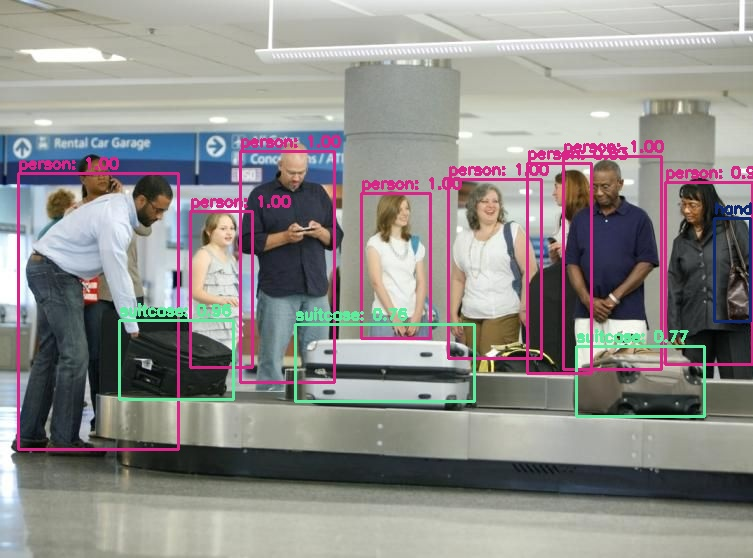
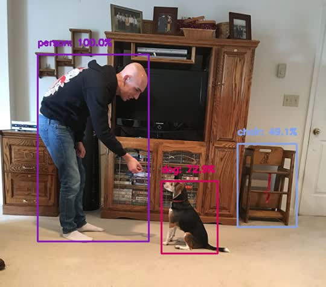

# OpenCV Object Detection

Two ready-to-run object detection examples that use only OpenCV's DNN module and NumPy. You don't need PyTorch or TensorFlow.

| Example | Model | Classes | Input | Speed (CPU) |
|---|---|---|---|---|
| [`yolo-object-detection`](yolo-object-detection) | YOLOv3 (Darknet), 416×416 | 80 COCO classes | image or video file | slower, more accurate |
| [`SSDMobile-opencv-real-time-object-detection`](SSDMobile-opencv-real-time-object-detection) | MobileNet SSD (Caffe), 300×300 | 20 PASCAL VOC classes | webcam, video or image | fast, real time |

| YOLOv3 on `baggage_claim.jpg` | MobileNet SSD on `living_room.jpg` |
|---|---|
|  |  |

## Requirements

- Python 3.10 or newer (tested with Python 3.12)
- OpenCV **4.x** (tested with 4.14.0) and NumPy (tested with 2.5)

> **Note:** OpenCV 5 removed the Darknet and Caffe model importers that these two models need.
> `requirements.txt` pins `opencv-python>=4.8,<5`. If you run the scripts with OpenCV 5, they stop
> with a message telling you to install OpenCV 4.

## Setup

```bash
git clone https://github.com/Walid-Ahmed/opencv-ObjectDetection.git
cd opencv-ObjectDetection
python -m venv .venv
source .venv/bin/activate          # Windows: .venv\Scripts\activate
pip install -r requirements.txt
```

The YOLOv3 weights (248 MB) are too large for GitHub. Download them once:

```bash
cd yolo-object-detection
python download_weights.py
```

The script saves `yolo-coco/yolov3.weights` and verifies its SHA-256 checksum. The MobileNet SSD model (22 MB) is already in the repo.

## 1. YOLOv3: images and videos

All commands below run from the `yolo-object-detection` folder.

### Detect objects in an image

```bash
python yolo.py --image images/baggage_claim.jpg
```

A window opens with the detections; press any key to close it. The terminal lists every object found:

```text
[INFO] loading YOLO from disk...
[INFO] YOLO took 7.093 seconds
  person          1.00  box=(18, 173, 160, 276)
  ...
  suitcase        0.96  box=(119, 320, 114, 79)
  handbag         0.93  box=(714, 218, 36, 103)
[INFO] 12 object(s) detected
```

To save the result instead of opening a window (useful on a server or over SSH):

```bash
python yolo.py --image images/soccer.jpg --output output/soccer.jpg --no-display
```

Sample images are in `images/`: `baggage_claim.jpg`, `dining_table.jpg`, `living_room.jpg` and `soccer.jpg`.

### Detect objects in a video

```bash
python yolo_video.py --input videos/airport.mp4 --output output/airport_output.avi
```

The script processes every frame and writes an annotated `.avi` at the original frame rate. YOLOv3 on a CPU takes about 3 seconds per frame (measured on a laptop), so a full clip can take several minutes. For a quick test, limit the number of frames:

```bash
python yolo_video.py --input videos/overpass.mp4 --output output/overpass.avi --max-frames 60
```

Add `--display` to watch the frames while they are processed (press `q` to stop). Sample videos are in `videos/`.

### Options

| Option | Default | Meaning |
|---|---|---|
| `--confidence` / `-c` | `0.5` | drop detections below this probability |
| `--threshold` / `-t` | `0.3` | overlap threshold for non-maxima suppression |
| `--yolo` / `-y` | `yolo-coco` | folder with `yolov3.cfg`, `yolov3.weights`, `coco.names` |

## 2. MobileNet SSD: real-time detection

All commands below run from the `SSDMobile-opencv-real-time-object-detection` folder.

### From your webcam

```bash
python real_time_object_detection.py
```

Press `q` in the window to quit. On macOS, the first run asks for permission to use the camera for your terminal app. Use `--input 1` to pick a second camera.

### From a video or image file

```bash
python real_time_object_detection.py --input ../yolo-object-detection/videos/car_chase_01.mp4
```

To save the annotated video without opening a window:

```bash
python real_time_object_detection.py --input ../yolo-object-detection/videos/car_chase_01.mp4 --output ssd_output.avi --no-display --max-frames 300
```

When the stream ends, the script prints the elapsed time and the average frames per second (about 8 to 14 FPS on a laptop CPU).

### Options

| Option | Default | Meaning |
|---|---|---|
| `--input` / `-i` | `0` | webcam index or path to a video/image file |
| `--confidence` / `-c` | `0.4` | drop detections below this probability |
| `--width` / `-w` | `960` | resize frames to this width |
| `--output` / `-o` | none | save the annotated video (`.avi`) |
| `--no-display` | off | do not open a window |
| `--max-frames` | `0` | stop after this many frames (`0` = no limit) |

## Project layout

```text
opencv-ObjectDetection/
├── requirements.txt
├── docs/                                  # example results shown above
├── yolo-object-detection/
│   ├── yolo.py                            # image detection
│   ├── yolo_video.py                      # video detection
│   ├── yolo_detector.py                   # shared YOLOv3 load / detect / draw code
│   ├── download_weights.py                # fetches yolov3.weights
│   ├── yolo-coco/                         # yolov3.cfg, coco.names (+ downloaded weights)
│   ├── images/                            # sample images
│   ├── videos/                            # sample videos
│   └── output/                            # results are written here (git-ignored)
└── SSDMobile-opencv-real-time-object-detection/
    ├── real_time_object_detection.py
    ├── MobileNetSSD_deploy.prototxt.txt
    └── MobileNetSSD_deploy.caffemodel
```

## How it works

Both scripts follow the same steps:

1. Load a pre-trained network with `cv2.dnn` (`readNetFromDarknet` for YOLOv3, `readNetFromCaffe` for MobileNet SSD).
2. Turn each frame into a blob with `cv2.dnn.blobFromImage`, which resizes, scales and mean-subtracts it the way the model expects.
3. Run a forward pass and keep detections above the confidence threshold.
4. For YOLOv3, apply non-maxima suppression (`cv2.dnn.NMSBoxes`) to remove overlapping boxes for the same object. MobileNet SSD already does this inside the network.
5. Draw the boxes and labels with `cv2.rectangle` and `cv2.putText`.

## What changed in the 2026 update

- Works with current OpenCV 4.x and NumPy 2. The old `getUnconnectedOutLayers()` indexing crashed on OpenCV 4.5.4 and newer; the scripts now use `getUnconnectedOutLayersNames()`.
- Removed the `imutils` dependency.
- The SSD script no longer forces the webcam: `--input` accepts a webcam index, video or image. It also exits cleanly at the end of a file (it used to crash on `vs.stop()`).
- Added `--output`, `--no-display` and `--max-frames` options, plus model paths that default to the script's own folder.
- Added `download_weights.py` with checksum verification, `requirements.txt`, and a `.gitignore`.
- Clear error messages when the weights, image or video are missing, or when OpenCV 5 is installed.

## Credits

These examples are based on Adrian Rosebrock's PyImageSearch tutorials:
[YOLO object detection with OpenCV](https://pyimagesearch.com/2018/11/12/yolo-object-detection-with-opencv/) and
[Real-time object detection with deep learning and OpenCV](https://pyimagesearch.com/2017/09/18/real-time-object-detection-with-deep-learning-and-opencv/).

- YOLOv3 by Joseph Redmon and Ali Farhadi ([paper](https://arxiv.org/abs/1804.02767), [Darknet](https://pjreddie.com/darknet/yolo/)).
- MobileNet SSD Caffe model by [chuanqi305/MobileNet-SSD](https://github.com/chuanqi305/MobileNet-SSD).
